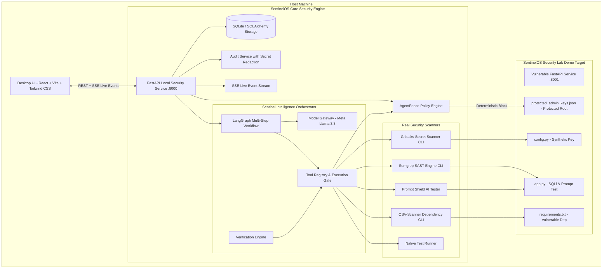

# SentinelOS — Autonomous AI Security Platform

[](LICENSE)
[](https://python.org)
[](https://fastapi.tiangolo.com)
[](https://langchain.com)
[](https://ai.meta.com/llama)
[](https://react.dev)

> **Build with AI. Stay in control.**

**SentinelOS** is a local-first, autonomous AI security platform that helps software engineers build with AI coding tools safely. Operating as an autonomous security engineer alongside developers, SentinelOS coordinates real host security scanners, independently enforces workspace policies, models exploit attack paths, generates verified remediations, and maintains an immutable audit trail.

---

## The Core Principle

```
The LLM reasons. 
The orchestrator coordinates. 
Security tools gather evidence. 
The policy engine controls actions. 
The verification engine checks results.
```

*An LLM is never trusted alone to enforce security or declare its own fixes successful.*

---

## Architecture Overview



---

## 10 Core Product Modules

1. **Workspace Manager**: Canonical host path verification, directory traversal protection (`..`, `/etc`, `~`), and protected file boundary definitions.
2. **AgentFence (Shield Mode)**: Independent deterministic policy engine evaluating every tool execution, blocking unauthorized writes to sensitive project assets.
3. **SecretVault**: Automated credential discovery using Gitleaks and entropy analysis with zero-leak redaction across logs, model prompts, and database records.
4. **Sentinel Intelligence**: Stateful LangGraph autonomous orchestrator that reasons over workspace layout, creates structured plans, selects approved tools, and interprets evidence.
5. **Supply Chain Guard**: Manifest inspector detecting vulnerable dependencies using OSV-Scanner against known CVEs.
6. **ThreatLens**: Interactive attack path graph connecting endpoints, source files, vulnerabilities, and databases, distinguishing confirmed evidence from inferred reachability.
7. **AttackLab**: Controlled local security test environment for non-destructive validation.
8. **Prompt Shield**: AI application security tester probing endpoints against prompt injection, hidden instruction extraction, and credential disclosure attempts.
9. **Fix & Verify Engine**: Generates minimal unified diff patches, safely applies them within workspace boundaries, reruns security scanners and pytest suites to objectively confirm resolution, with one-click rollback support.
10. **Audit & Control Center**: Centralized, immutable event history tracking every investigation cycle, tool run, and policy decision.

---

## Quick Start (Installation & Execution)

### Prerequisites

- **Python**: 3.12 (or 3.11+)
- **Node.js**: v18+ & npm
- **Host Security Scanners** (Optional but recommended; native fallbacks included):
  ```bash
  brew install gitleaks semgrep osv-scanner
  ```

### 1. Setup & Installation

Clone repository and run automated setup:

```bash
git clone https://github.com/sential/sential.git
cd sential

# Run automated environment setup
./scripts/setup.sh
```

### 2. Configure Environment

Copy `.env.example` to `.env`:

```bash
cp .env.example .env
```

To enable Meta's supported Llama model, configure your API credentials:
```env
MODEL_PROVIDER=meta
MODEL_BASE_URL=https://api.groq.com/openai/v1
MODEL_API_KEY=your_meta_compatible_api_key_here
MODEL_NAME=llama-3.3-70b-versatile
```
*(If no API key is provided, SentinelOS automatically activates its deterministic local reasoning engine, guaranteeing complete functionality and test execution offline).*

### 3. Launch SentinelOS

Start backend and desktop frontend simultaneously:

```bash
./scripts/start_all.sh
```

- **Desktop UI**: [http://127.0.0.1:5173](http://127.0.0.1:5173)
- **Local Security API**: [http://127.0.0.1:8000](http://127.0.0.1:8000)
- **API Documentation**: [http://127.0.0.1:8000/docs](http://127.0.0.1:8000/docs)

---

## 3-Minute Demo Journey

Follow this sequence to test all features with zero manual code editing:

1. **Open Dashboard**: Visit `http://127.0.0.1:5173`. Notice the `SentinelOS Security Lab` workspace is pre-selected and all scanners are verified.
2. **Run Autonomous Audit**: Click the **Run Autonomous Audit** button in the header.
3. **Watch Orchestration**: In the **Investigation Center**, watch LangGraph execute discovery, planning, Gitleaks, Semgrep, OSV-Scanner, and Prompt Shield.
4. **Inspect Findings**: Open the **Findings** tab to view concrete evidence for the hardcoded secret, SQL injection, and vulnerable `urllib3`.
5. **Explore Attack Paths**: Open **Attack Paths** to inspect the ThreatLens graph mapping the exploit chain from `/api/users/search` to the database.
6. **Apply Patch & Verify**: Open **Fix & Verify**, review the proposed unified diff for the SQL injection in `app.py`, click **Apply Patch to Workspace**, and then click **Run Verification & Tests**. The Verification Engine reruns Semgrep and pytest, confirming **VERIFIED FIXED**.
7. **Trigger Policy Denial (Scenario E)**: Click **Test Policy Denial** in the top header. AgentFence immediately intercepts the unauthorized write to `protected_admin_keys.json` with a hard **DENY**.
8. **Reset Demo**: Click **Reset Lab** to restore the testbed to its initial vulnerable state.

---

## Running Automated Tests

Run the backend test suite:

```bash
PYTHONPATH=backend backend/.venv/bin/pytest -v backend/tests
```

Run the demo lab verification suite:

```bash
backend/.venv/bin/pytest -v demo_lab/test_suite.py
```

---

## Project Structure

```
sential/
├── backend/
│   ├── app/
│   │   ├── main.py                     # FastAPI application setup & CORS
│   │   ├── config.py                   # Pydantic BaseSettings & configuration
│   │   ├── db/                         # SQLAlchemy 2.0 session & database models
│   │   ├── schemas/                    # Pydantic v2 schemas
│   │   ├── api/                        # REST API endpoints & SSE stream
│   │   ├── core/
│   │   │   ├── model_gateway.py        # Meta Llama 3.3 client with redaction
│   │   │   ├── prompts.py              # Versioned structured system prompts
│   │   │   ├── orchestrator.py         # Stateful LangGraph autonomous workflow
│   │   │   ├── policy_engine.py        # Deterministic PolicyEngine & boundary checks
│   │   │   ├── verification_engine.py  # Patch generator, test runner & re-scanner
│   │   │   ├── audit_service.py        # Append-only audit logger with redaction
│   │   │   ├── event_bus.py            # SSE real-time pub/sub
│   │   │   └── agent_fence.py          # AI coding tool gatekeeper
│   │   └── tools/                      # Tool execution service (Gitleaks, Semgrep, OSV)
│   ├── tests/                          # 12 automated test suites
│   ├── requirements.txt
│   └── run.py
├── frontend/
│   ├── src/
│   │   ├── App.tsx                     # Main desktop application coordinator
│   │   ├── components/                 # Reusable UI components (DiffViewer, GraphViewer)
│   │   ├── pages/                      # 10 complete screens
│   │   └── types/                      # TypeScript schemas
│   ├── package.json
│   ├── vite.config.ts
│   └── tailwind.config.js
├── demo_lab/                           # SentinelOS Security Lab (Isolated Demo Target)
│   ├── app.py                          # Controlled SQL injection & prompt endpoint
│   ├── config.py                       # Hardcoded synthetic demo key
│   ├── requirements.txt                # Documented vulnerable package
│   ├── protected_admin_keys.json       # Scenario E protected file
│   ├── test_suite.py                   # Automated verification tests
│   └── reset.py                        # Deterministic 1-click reset script
├── scripts/
│   ├── setup.sh                        # Automated environment setup
│   ├── start_all.sh                    # Dual-service launcher
│   └── reset_demo.sh                   # Demo lab reset script
├── docs/
│   ├── architecture.md                 # System architecture specification
│   ├── demo_script.md                  # 3-minute hackathon demo script
│   └── hackathon_features.md           # Original contributions & limitations
├── docker-compose.yml
├── .env.example
└── README.md
```

---

## License

This project is licensed under the MIT License - see the [LICENSE](LICENSE) file for details.
