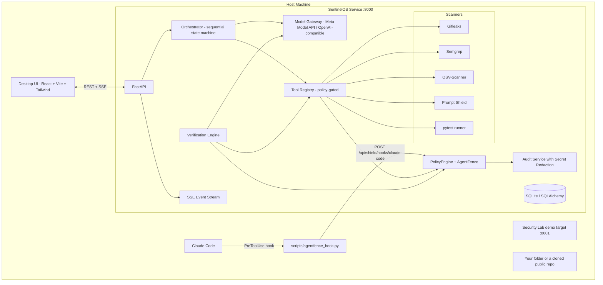

# SentinelOS — Autonomous AI Security Platform

[](LICENSE)
[](https://python.org)
[](https://fastapi.tiangolo.com)
[](https://ai.meta.com)
[](https://react.dev)

> **Build with AI. Stay in control.**

**SentinelOS** is a local-first security engineer for developers who ship code with AI coding agents. It scans a project with real security tools, uses Meta's models to plan the investigation, connect findings into attack paths and draft fixes, then **proves** each fix by re-scanning and re-running tests. Its AgentFence policy engine plugs into Claude Code and blocks the agent from reading or writing protected files such as `.env`.

---

## The Core Principle

```
The LLM reasons.
The orchestrator coordinates.
Security tools gather evidence.
The policy engine controls actions.
The verification engine checks results.
```

*An LLM is never trusted alone to enforce security or declare its own fixes successful.*

Concretely:
- The model **plans** which scanners to run, but every tool call passes the deterministic `PolicyEngine` first.
- The model **drafts** a patch as exact search/replace edits. SentinelOS applies them to the real file only if every edit matches exactly once and the result compiles. The diff you see is computed by SentinelOS, not copied from model output.
- A fix is **VERIFIED** only when the original scanner no longer reports the finding and the test suite shows no new failures compared to a pre-patch baseline.
- Every UI label shows which model actually served a task, or says "offline fallback" when no key is configured.

---

## Architecture



### Which Meta model does what

Every task routes to the Meta Model API. Edit the model IDs in `.env`.

| Task | Meta model |
| :--- | :--- |
| Investigation planning, discovery | `muse-spark-1.3` |
| Finding interpretation, ThreatLens attack paths, exploit planning | `muse-wonder-1.0` |
| Patch drafting (Fix & Verify, Attack Lab fixes) | `muse-wonder-1.0` |

With no API key, a deterministic offline engine takes over so the app and tests still run. Planning uses a fixed scanner plan, attack paths are built strictly from scanner evidence, and fixes come from a small rule-based engine (parameterized SQL for f-string queries, `os.getenv` for hardcoded secrets, version pins for known-vulnerable dependencies). The UI labels these results as offline fallback, not as model output.

---

## The Attack Lab — prove it, don't just report it

Most scanners hand you a list. SentinelOS takes any repo and **actually breaks into a disposable copy of it**:

1. **Clone with history.** Paste a public repo URL; SentinelOS clones it (full history for origin tracing).
2. **Scan.** Secrets, SAST, dependencies, prompt-injection.
3. **Sandbox.** It copies the app into a locked-down Docker container (no host files, dropped privileges, CPU/RAM/PID limits, loopback-only port, auto-destroyed). Your real files are never touched.
4. **Attack.** It reads the app's live routes, Muse Wonder plans exploits, and SentinelOS fires them **only at the sandbox**. Each finding gets a verdict from the real HTTP response: 🔴 BREACHED, 🟢 SURVIVED, or NOT REACHABLE.
5. **Origin.** `git blame` shows which commit introduced each hole, who wrote it, and whether an **AI agent co-authored it**.
6. **Fix & re-attack.** Muse Wonder fixes the breached findings in the copy, SentinelOS rebuilds and fires the same exploits again, and shows BREACHED → SURVIVED.
7. **Report.** A one-click HTML report: scorecard (breached → closed, how many from AI-authored commits) and per-finding proof (request/response before and after).

Requires Docker. Only Python FastAPI/Flask apps are auto-attacked today; other repos still get scan, origin, fix and report.

**Try it live:** paste [`https://github.com/sajosam/sentinelos-demo-lab`](https://github.com/sajosam/sentinelos-demo-lab) into *Clone & Scan*. It is an intentionally vulnerable FastAPI app (SQL injection, hardcoded secret, prompt injection) that the Attack Lab breaches, fixes, and re-attacks end to end.

## Core Modules

1. **Workspaces**: register a local folder, the bundled Security Lab, or **clone a public GitHub/GitLab/Bitbucket repo** by URL. Cloned repos are marked untrusted, so their code (including tests) is never executed.
2. **AgentFence**: deterministic `ALLOW / DENY / REQUIRE_APPROVAL` decisions on workspace boundaries and protected paths (`.env`, `*.key`, `id_rsa`, plus per-workspace rules). It serves SentinelOS's own tools and **Claude Code via a PreToolUse hook**.
3. **Secret scanning**: Gitleaks plus a pattern-based fallback. Secrets are redacted from logs, model prompts, SSE events and the database.
4. **Investigation orchestrator**: discovery, model-generated plan, policy-gated scanner runs, an adaptive AST dataflow trace when SQL injection is suspected, interpretation, attack-path modeling, then an automatic fix-and-verify attempt on the highest-risk fixable finding.
5. **Supply Chain Guard**: OSV-Scanner plus a manifest inspector for known-vulnerable pins.
6. **ThreatLens**: attack-path graphs. Every edge is labeled CONFIRMED (backed by scanner evidence) or INFERRED.
7. **Prompt Shield**: injection, instruction-leak and secret-extraction probes against an AI endpoint.
8. **Fix & Verify**: model-drafted patch, exact-match application, syntax check, drift check, baseline tests, re-scan, regression-aware verdict, one-click rollback.
9. **Audit ledger**: append-only record of every tool run, policy decision, patch and verification.

---

## Quick Start

### Prerequisites

- Python 3.11+ (3.12 recommended), Node.js 18+, `git`
- Optional but recommended host scanners (pure-Python fallbacks are built in):
  ```bash
  brew install gitleaks semgrep osv-scanner
  ```

### 1. Setup

```bash
./scripts/setup.sh
cp .env.example .env
```

### 2. Configure Meta models

```env
PROD_MODEL_BASE_URL="https://api.meta.ai/v1"
PROD_MODEL_API_KEY="..."                        # or META_API_KEY
```

The sidebar shows the live model, or "Offline fallback" when no key is set.

### 3. Launch

```bash
./scripts/start_all.sh
```

- UI: http://127.0.0.1:5173
- API: http://127.0.0.1:8000 (OpenAPI docs at `/docs`)

---

## Protect Claude Code with AgentFence

With SentinelOS running, add this to `.claude/settings.json` in your project (or `~/.claude/settings.json`):

```json
{
  "hooks": {
    "PreToolUse": [
      {
        "matcher": "Read|Write|Edit|MultiEdit|NotebookEdit|Grep|Glob|Bash",
        "hooks": [{ "type": "command", "command": "python3 /absolute/path/to/sential/scripts/agentfence_hook.py" }]
      }
    ]
  }
}
```

The **AgentFence & Audit** tab shows this snippet with your real path filled in. Then ask Claude Code to `cat .env` inside a registered workspace. The call is denied, the reason is shown to the agent, and a live toast appears in the SentinelOS UI.

- Paths outside any registered workspace are always allowed.
- If SentinelOS is not running, the hook allows the call and prints a warning. Set `SENTINEL_FAIL_CLOSED=1` to deny instead.

---

## 3-Minute Demo Journey

1. **Connect**: open the UI and choose *Scan Security Lab*, or paste a public repo URL into *Clone & Scan*.
2. **Watch the investigation**: the Scan Timeline shows each step with the model that served it (e.g. `planner: muse-spark`), every scanner run, and the adaptive dataflow trace.
3. **Findings and Attack Paths**: real Gitleaks/Semgrep/OSV evidence and a ThreatLens graph that separates confirmed from inferred edges.
4. **Fix & Verify**: the patch is tagged `model:muse-wonder-1.0` or `rule-based`. Apply it, then verify. The verdict comes from the re-scan and test comparison, not from the model.
5. **AgentFence**: with the hook installed, ask Claude Code to read `protected_admin_keys.json` in the Security Lab. It is denied live. *Simulate Blocked Write* shows the same thing without Claude Code.
6. **Reset Lab** restores the vulnerable demo files.

---

## Tests

```bash
PYTHONPATH=backend backend/.venv/bin/pytest -v backend/tests        # backend suite (runs offline)
backend/.venv/bin/pytest -v demo_lab/test_suite.py                  # the Security Lab's own tests
```

Backend tests use `DATABASE_URL` (default `./sentinel.db`). Point it at a scratch file to keep your local data clean.

---

## Project Structure

```
sential/
├── backend/app/
│   ├── api/endpoints/       # REST + SSE (workspaces incl. /clone, investigations, shield incl. /hooks/claude-code, ...)
│   ├── core/
│   │   ├── orchestrator.py        # sequential investigation state machine
│   │   ├── model_gateway.py       # OpenAI-compatible client, per-task model routing, redaction, offline fallback
│   │   ├── prompts.py             # versioned JSON-only prompts
│   │   ├── policy_engine.py       # deterministic ALLOW/DENY/REQUIRE_APPROVAL
│   │   ├── agent_fence.py         # agent-facing wrapper + Claude Code hook evaluation
│   │   ├── verification_engine.py # propose / apply / verify / rollback
│   │   ├── tool_registry.py       # policy-gated tool execution
│   │   ├── audit_service.py       # append-only audit + redaction
│   │   └── event_bus.py           # in-process SSE pub/sub
│   └── tools/               # gitleaks, semgrep, osv, prompt shield, AST flow tracer, pytest runner
├── frontend/src/            # React UI: Overview, Investigations (Timeline / Attack Paths / Fix & Verify / AgentFence & Audit), Findings, Settings
├── demo_lab/                # intentionally vulnerable target app + reset script
├── scripts/                 # setup, start_all, reset_demo, agentfence_hook.py
└── docs/
```

---

## Roadmap / Future Scope

- **Authenticated & multi-file attacks.** Teach the Attack Lab to log in (forge or obtain a token) and chain findings across files, so apps behind auth — not just single-file targets — get a real breach verdict.
- **More stacks in the sandbox.** Extend auto-boot beyond Python FastAPI/Flask to Node/Express, Django and Go, with Poetry/Pipenv/npm dependency resolution.
- **CI/CD mode.** A GitHub Action that runs an investigation on every pull request and blocks the merge when a new CRITICAL/HIGH finding is introduced — catching AI-written bugs before they land.
- **More guarded agents.** Extend the AgentFence hook beyond Claude Code to Cursor, Copilot and other agents, with a shared policy format.
- **Stronger isolation.** Move from path-based command checks toward a kernel-level sandbox for arbitrary processes.

---

## Limitations

- AgentFence enforces policy on SentinelOS's own tools and on agents that call it, currently Claude Code through its hook. It is not a kernel-level sandbox for arbitrary processes.
- Bash commands are checked by resolving path-like arguments against protected paths. Shell constructs that build paths dynamically can evade this.
- The offline rule-based fixer covers only a few common vulnerability shapes. Everything else needs a configured model or a manual fix.

## License

MIT. See [LICENSE](LICENSE).
