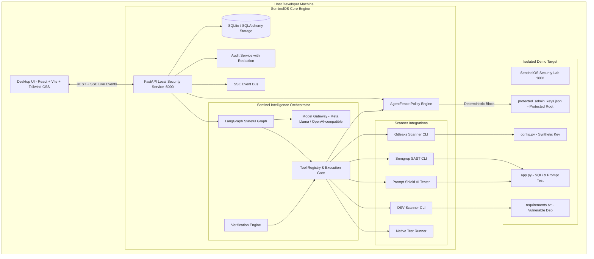

# SentinelOS Architecture Specification

**Build with AI. Stay in control.**

SentinelOS is a local-first, autonomous AI security platform designed to help developers build software with AI coding agents safely.

---

## 1. Core Architectural Principle

```
The LLM reasons. 
The orchestrator coordinates. 
Security tools gather evidence. 
The policy engine controls actions. 
The verification engine checks results.
```

An LLM is **never** trusted alone to enforce security, make unrestricted host decisions, or declare its own code patches successful.

---

## 2. System Architecture Diagram



---

## 3. Component Breakdown

### A. Desktop Frontend (React + TypeScript + Vite + Tailwind CSS)
- **10 Core Screens**:
  1. **Onboarding & Readiness**: System check verifying host scanner binaries (`gitleaks`, `semgrep`, `osv-scanner`) and Meta model gateway configuration.
  2. **Overview**: Executive dashboard with metric cards, recent blocked actions, severity distributions, and quick scenario triggers.
  3. **Workspaces**: Workspace manager enforcing canonical paths and protected asset rules.
  4. **Shield Mode (AgentFence)**: Policy mode switcher, registered AI coding agents, and real-time blocked vs monitored metrics.
  5. **Investigation Center**: Live LangGraph workflow visualizer, step-by-step progress, LLM reasoning, collected evidence, cancellation.
  6. **Findings**: Multi-facet filterable table/cards with code snippets, severity badges, remediation suggestions.
  7. **Attack Paths (ThreatLens)**: Visual nodes (file, API, secret, db, vulnerability) & edges (reads, writes, calls, exposes) distinguishing confirmed vs inferred relationships.
  8. **Fix & Verify**: Unified diff viewer, patch application in workspace boundaries, test runner rerun, before-and-after scanner comparison.
  9. **Activity & Audit**: Immutable event timeline with filterable actions, policy decisions, and sanitized evidence.
  10. **Settings**: Configurable Meta model (Base URL, API Key, Model ID), tool detection status, telemetry toggles.

### B. Local Security Service (FastAPI + SQLAlchemy + Pydantic v2)
- Serves local-only API (`http://127.0.0.1:8000`).
- Validates canonical filesystem paths (`Path.resolve().is_relative_to(canonical_root)`).
- Rejects path traversal (`..`, `/etc`, `~`).
- Employs append-only audit logging with automated credential redaction.

### C. Policy Engine & AgentFence
- Independent deterministic evaluator returning `ALLOW`, `DENY`, or `REQUIRE_APPROVAL`.
- Evaluates: requested tool, workspace boundaries, file paths, command/arguments, and action risk level.
- Shield Mode locks sensitive files (`.env`, `protected_admin_keys.json`, `*.key`) against modification.
- Model output **cannot** override a policy decision.

### D. Model Gateway
- Provider-independent client configured for Meta's supported models (`llama-3.3-70b-versatile`, `meta-llama/Llama-3.3-70B-Instruct`).
- Redacts sensitive context prior to calling remote APIs.
- Employs retry logic, timeouts, and structured JSON parsing.
- Deterministic fallback reasoning engine ensuring full offline functionality and robust test execution.

### E. Security Scanner Integrations
- **Gitleaks** (CLI v8.30.1): Secret scanning across commits and working directories.
- **Semgrep** (CLI v1.182.0): Static application security testing (SAST) for SQL injection and unsafe patterns.
- **OSV-Scanner** (CLI v2.7.0): Supply chain known CVE matching against package manifests.
- **Prompt Shield Tester**: Automated injection probes, instruction leak tests, and secret extraction defense checks.
- **Native Test Runner**: Automated pytest test execution for patch regression testing.

### F. Verification Engine
- Generates unified diff patches within workspace boundaries.
- Creates backup of original file content before modification.
- Reruns scanners and automated test suites on modified codebase.
- Evaluates before-and-after results: `passed`, `failed`, or `inconclusive`.
- Supports one-click rollback to restore previous state.

---

## 4. Security Principles

1. **Subprocess Isolation**: Commands are invoked using argument arrays (`subprocess.run(["gitleaks", ...])`), strictly rejecting unrestricted shell strings.
2. **Canonical Boundaries**: Path resolution guarantees tools only operate inside the permitted workspace.
3. **Secret Redaction**: Credentials and sensitive tokens are scrubbed from logs, model prompts, SSE streams, and database storage.
4. **Append-Only Audit**: All system actions, tool executions, and policy decisions are immutably logged with timestamps and justifications.
